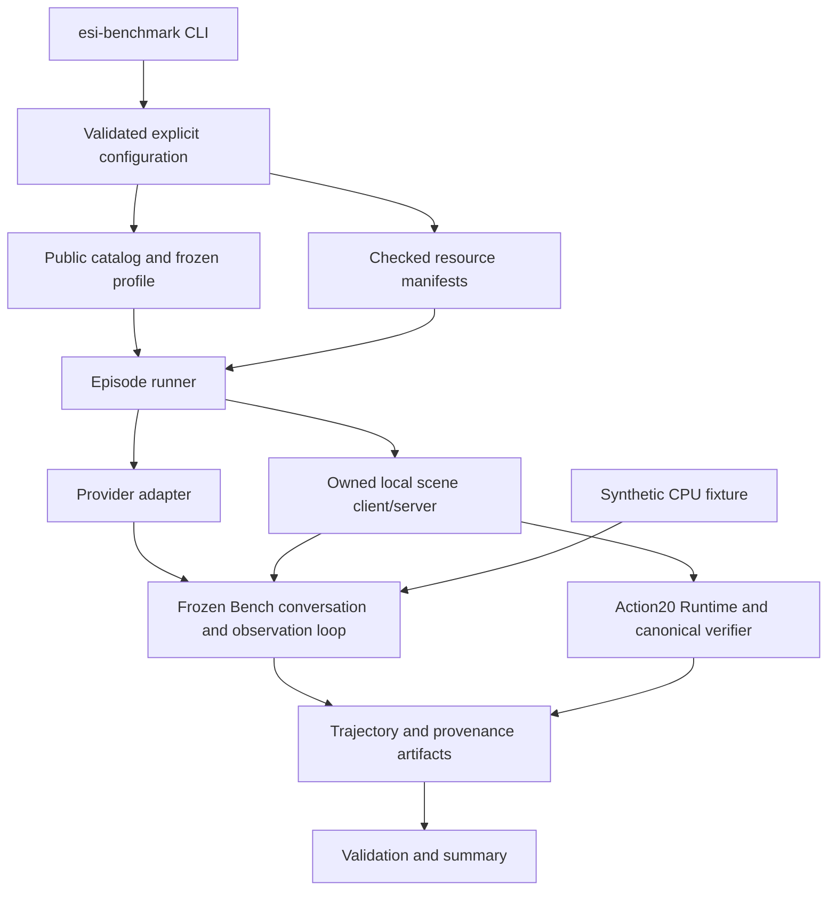

# Architecture

The public package is a thin integration layer around frozen evaluation code.
It gives users one command-line workflow while preserving the original Action20
executor, observation construction, episode loop and scoring implementation.



The fixture selects the CPU route. It supplies scripted observations and provider
responses to the real conversation loop; it does not instantiate a simulator or
establish physical task success.

| Area | Responsibility | Boundary |
| --- | --- | --- |
| Public CLI and configuration | Validate paths, choose an explicit profile and mode, expose the user workflow | Does not discover or attach to internal services. |
| Task catalog and preparation manifests | Keep task identities, instructions, resource hashes and version bindings together | Public catalog is an allowlist; private evaluator inputs stay outside model context. |
| Model adapter | Select provider transport and supply credentials from an environment variable | Does not alter Action20 or scoring rules. |
| Episode runner | Delegate budget, Marker transitions, retry, termination and history to frozen Bench code | Does not implement a second competing episode loop. |
| Action Runtime and verifier | Execute actions and evaluate the declared final/process contract | Does not substitute final-state success for a declared history requirement. |
| Artifact validation and summary | Check references and report recorded outcomes with provenance | Does not infer official success from `Q=1` alone. |

```text
src/esi_benchmark/             public package and command entry point
  _vendor/bench/              frozen Bench files in their original layout
    lab/                      model transport and scene-server dependency closure
  _vendor/runtime/            frozen Action/Simulator/Oracle source layout
docs/                         contracts, usage and release boundaries
tests/                        imported contract tests and integration checks
provenance/                   source identities and per-file import records
```

The wheel must contain the vendored Python files and their JSON/text resources.
The bootstrap adds candidate-owned vendor roots to the import path. No mutable
symlink or import fallback to the original repositories is needed. Preserving
the upstream layout avoids a broad import rewrite and makes file-by-file
comparison possible. Vendoring is an implementation detail; public users invoke
`esi-benchmark` and the documented package interface.

The integrated profile is `l0-english-v2`, with 100 public task definitions.
Each Live request must pass its frozen private-input checks; CPU readiness and
actual simulator completion are distinct evidence:

| Component | Frozen revision |
| --- | --- |
| Bench | `5b8d2b37fd7d97b161e88de4d438ec789c78f9b4` |
| Action / Simulator / Oracle | `9b992b6797330a836e9533e5409627bf63f7d94b` |

The source-directory snapshot is recorded separately in
[source_roots.json](../provenance/source_roots.json). The Bench directory's current
HEAD is newer than this profile and includes different provider/protocol logic.
Its uncommitted experimental files are recorded as source state rather than
silently included. Task inputs that were not committed are identified by their
individual hashes; a repository HEAD cannot identify their contents.

The source package's dependency list omitted some native-loader fallback files.
The candidate resource manifest includes the exact referenced fallback closure
and relocates it with the original inputs; it does not change acceptance status
or bypass a preparation gate. The [per-task resource report](../reports/TASK_ASSET_CPU_VALIDATION.md)
records coverage. Frozen `wall_clock_seconds: 3600` metadata remains metadata:
the source loop has no consumer, and the old outer scheduler is not reproduced.
See [source limitations](../reports/SOURCE_LIMITATIONS.md).

L1 A/M/V, Physical P and L2 use different frozen runtime and harness revisions.
Catalog presence does not route them through the L0 implementation. Each future
executable profile needs its own dependency closure, compatible interface and
evidence. Historical Common and Agent CLI runs also have different harnesses and
budgets; the candidate does not claim to reproduce all such runs.

Configuration owns external asset locations, model endpoint, cache, output and
runtime directories. Generated artifacts record the selected task/profile and
source hashes. Paths retained only in source audit metadata do not make the
original machines operational dependencies.

Read [Action20](ACTION20.md), [model integration](MODELS.md) and
[trajectory format](TRAJECTORIES.md) for the detailed boundaries. The
[Live validation plan](LIVE_VALIDATION.md) defines the evidence still needed
before making simulator reproducibility claims.
