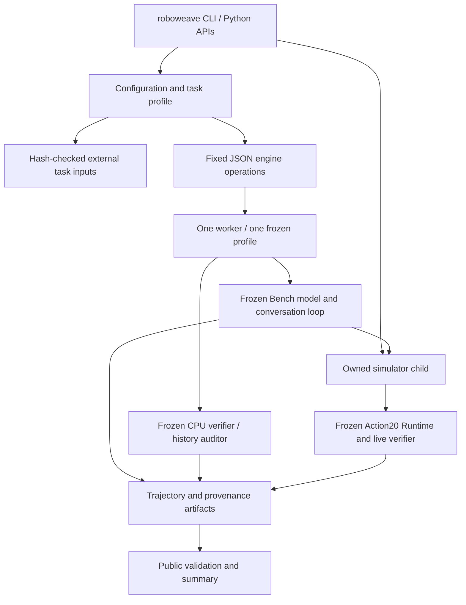

# Architecture

The public package owns task selection, resource verification, configuration and
artifact reporting. Frozen evaluation code runs behind an explicit, short-lived
process boundary. Importing the public package, validating a model configuration,
scoring a record or running an episode does not change the caller's `sys.path`
or install legacy `Agent`, `lab`, `model_client` or `behavior_hl` modules.



| Module | Responsibility | Boundary |
| --- | --- | --- |
| `tasks`, `profiles` | Public task identities, version selection and source integrity | A task profile selects exact Bench and Runtime revisions; directory dates and current development HEAD are not identities. |
| `assets`, `adapters` | Verify and relocate externally supplied evaluator resources; bind the native entry point | Hidden goals, reset snapshots and licensed assets stay outside model input and distribution. Native adapter inspection runs in the profile worker. |
| `config`, `cli`, `runtime` | Explicit local paths and owned simulator lifecycle | No discovery of or attachment to internal residents, schedulers or services. |
| `engine` | Fixed JSON request/response protocol | Each operation uses a new isolated Python process and exactly one profile. No persistent service or arbitrary remote function dispatch. |
| `models`, `offline`, `scoring` | Public configuration, episode, synthetic replay and evidence-scoring APIs | JSON-compatible values cross the boundary; native provider and verifier objects stay private. |
| `_native` | Private compatibility boundary for frozen source layouts and legacy imports | Only worker processes and explicitly designated upstream test processes activate legacy import paths. |
| `trajectory` | Artifact references, integrity and conservative result summaries | Reads recorded evidence; does not recompute physical success or equate Q=1 with protocol completion. |

## Source layout and profiles

```text
src/roboweave/
  profiles.py                 pure profile/source selection and hash verification
  engine.py                   public fixed-operation worker client
  _native/                    private worker dispatch and frozen-code adapters
  _vendor/bench/              default frozen Bench source layout
  _vendor/runtime/            default frozen Runtime source layout
  _vendor/revisions/         additional immutable bench/runtime revision snapshots
  data/source_bundles.json    installed source locations and manifest hashes
  data/tasks/                 public catalog and exact profile bindings
  data/assets/                external-resource hash manifests
```

Each unique Bench or Runtime revision is stored once and may be selected by
several profiles. A revision snapshot retains the original `lab`, `src`,
`scripts`, `configs` and resource relationships required by its actual dependency
closure. There are no mutable links to development worktrees, generated source
caches or source rewrites that rename executor classes. The installed source
manifest identifies every shipped file and the documented candidate adaptations.
The worker verifies the selected manifests before importing frozen code.

Different versions of the same legacy module name cannot coexist safely inside
one Python interpreter. A worker therefore rejects profile switching and checks
loaded module origins. The public caller can use multiple profiles sequentially
or concurrently because each operation receives its own worker. Third-party
simulator code remains in the separately owned simulator process.

## Public worker protocol

The request envelope contains `schema_version`, `operation`, `profile` and
`payload`. The allowlisted operations are `inspect`, `validate_model`, `replay`,
`score`, `task_info` and `episode`. Unknown operations, fields, duplicate JSON
keys, non-finite values and conflicting profile names are rejected. Operations
accept only the fields they need; they cannot request arbitrary module imports
or method execution. Worker diagnostics use stderr and results use stdout.

The caller launches an isolated interpreter with its own session. It terminates
only that session on cancellation or timeout; the CLI independently owns and
cleans up the simulator it launched. CPU inspection operations have a bounded
execution timeout. L0 and L1 episode operations add no new overall wall-clock
limit. Per-task action/model-call budgets, provider timeouts and the frozen
termination rules remain those of the selected implementation.

For `l2-collection37`, the engine restores the historical Common safe-point wall
watchdog. Its declared 7200-second task budget starts at **model worker process
creation**, measured with Linux `/proc/<pid>/stat` start ticks and `/proc/uptime`,
as in the original observer. Scene loading happens before this worker exists and
is excluded. Expiry permits one `SIGINT` to the owned model process group only
when the exact run/task identity matches and fresh artifact observations report
`STARTING_PROVIDER_CALL`, `WAITING_PROVIDER` or `RETRYING_PROVIDER`. The original
policy also lists `AGENT_CLI_RUNNING`; this candidate route runs Common, and does
not apply its watchdog to an AgentCLI harness.

The phase classifier retains the original priority: provider error/retry,
protocol processing, response parsing, request waiting, then call startup.
Identity, safe phase, owned process group and SIGINT disposition are checked
again before the interrupt. Missing or malformed observations, an inflight
action, response parsing, preflight, ignored SIGINT or lost ownership produce no
interrupt. The model may therefore run beyond 7200 seconds until an observable
safe point; this is not a hard deadline, and there is no timeout-driven TERM/KILL
escalation. Phase observations are not a simulator-side lock; the historical
check-to-signal race remains a separate Live validation concern.

The engine writes the requested threshold, observed elapsed time/phase, PID,
experiment/run identity and sent signal to `private/model_wall_timeout.json`.
It leaves the native result untouched. Every profile launches the Common loop
with `pause_on_client_failure=True`, as each frozen `bench.py model start` does.
Exhausted provider retries and terminal protocol failures therefore end as
`PAUSED_PROVIDER` or `PAUSED_MODEL_PROTOCOL` with their native checkpoint, not as
a scored `client_error` episode, and the native automatic provider retry windows
remain enabled. L2 preserves `PAUSED_INTERRUPTED` when watchdog interruption
reaches that branch. Paused attempts do not gain an invented final score; this
candidate does not resume them. The run record reports
`owned_common_safe_point_watchdog/model_wall_timeout-v1` for L2.

The policy is adapted from `scene_backfill.py` (`SAFE_MODEL_INTERRUPT_PHASES`,
`_task_wall_timeout_evidence`, `_wall_timeout_evidence`, `_interrupt_owned_model`;
source SHA256 `c41a0950ece03ab3cbe07026818c9df89ffd1ce2f572188cb56a10beef0ff4cc`)
and the Common `monitor.py::collect_run_progress` phase rules (SHA256
`9e1a94adddc151dcc94302e27e91321c9f21fa4fd1fdf453456a7e29da46b573`).
Only process ownership and observation access are adapted to the local worker.
Provider-directory discovery is bounded by the declared model-call budget.
The historical L2 collection included budgets up to 3,810 calls. The formal
L2 selection includes budgets up to 1,950 calls and uses the same phase
classification and stop conditions. No zero-Q early-stop or historical scheduler/queue is introduced.

Model API keys remain environment variables. JSON contains the selected
`api_key_env` name, never the key value. Public `validate_model_config()` performs
provider validation in a CPU worker without requests. The public episode API
accepts model configuration and a task binding, and checks its public handle,
instruction, budget and provenance against the frozen catalog before creating
a provider or contacting the scene. Recorded model names use the frozen
provider's whitespace normalization, including the watchdog identity check.
`create_provider()` is now a
private implementation detail, not an in-process extension API. Integrations
that imported this previous candidate helper should use `run_episode()` or the
CLI with an explicit model endpoint.

Provider failure messages and diagnostic previews redact credential headers and
the exact credential sent with the failing request before applying the preview
length limit. Raw response byte counts and SHA256 digests remain available for
audit, and the original failure and retry classifications are retained. Invalid
credential characters are rejected with a fixed message before HTTP header
serialization can echo their value.

## Evaluation and evidence

Synthetic replay exercises the frozen conversation loop with scripted public
observations and model outputs. It creates protocol and artifact evidence;
it does not instantiate a simulator or establish task success. Evidence scoring
uses the selected frozen verifier and process/history auditor. Supplied predicate
truth is recorded input, not a measurement of a real scene.

Live execution continues to use the native prepared-state or task-family entry
point and its own admission gates. L0/A/M, V, P and L2 differences remain explicit
in profile selection and native adapters. V results preserve canonical goals and
protocol completion separately; P preserves Physical qualification. L2 reads
the native combined `task_success`/`status` after its process, Physical and V
checks, rather than reusing P's result schema.

Raw scores and required process/V evidence are archived without rewriting them.
Run records identify the chosen profile, source revisions and actual candidate
runner. A source manifest proves which implementation was bundled; CPU tests,
installation checks and Live validation are separate claims. Consult
[the support matrix](SUPPORT_MATRIX.md), [scoring](SCORING.md),
[model integration](MODELS.md), [trajectory format](TRAJECTORIES.md) and
[the independent Live plan](LIVE_VALIDATION.md) for their current evidence and
limitations.
